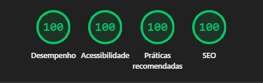

# Luma — landing page

A responsive landing page for **Luma**, an online-learning brand, built from the supplied Figma design for the Buzzvel Front-End challenge.

- **Live demo:** https://buzzvel-coding-challenge.vercel.app/
- **Lighthouse:**

  

## Tech stack

| Area | Choice |
|---|---|
| Framework | Next.js 16 (App Router), React 19, React Compiler |
| Language | TypeScript (strict) |
| Styling | Tailwind CSS v4 (design tokens in `@theme`) |
| Forms | React Hook Form + Zod |
| Lint / format | Biome (with the `next` and `react` rule domains) |
| Tests | Vitest + Testing Library (components), Playwright (browser) |
| Package manager | pnpm |

There are no UI libraries. Icons are small typed inline SVG components. All content is typed local data in `src/data/`.

## Getting started

Requires Node 20.9+ (developed on Node 24) and pnpm.

```bash
pnpm install
pnpm dev          # http://localhost:3000
pnpm build        # production build (the page is fully static)
pnpm start        # serve the build
pnpm lint         # Biome: lint + format check
pnpm format       # Biome: write formatting
# generates route types, then tsc --noEmit
pnpm test         # component tests (Vitest)
pnpm test:e2e     # browser tests (Playwright): builds and serves the app on port 3100
```

Playwright uses the installed Google Chrome. Without it, run `pnpm exec playwright install chrome`.

Open Graph URLs (`og:url`, `og:image`) are built from `SITE_URL` when it is set. Without it, a Vercel build uses the project's production domain automatically.

## Project structure

```
src/
  app/              layout (fonts, metadata, skip link), page, globals.css (tokens),
                    icon and opengraph-image (generated at build time)
  assets/fonts/     static TTF files used only to generate those images
  components/
    layout/         Header, MobileMenu, Footer
    sections/       one component per page section (+ ContactForm and its test)
    ui/             Button, Heading, Overline, Section, Container, Card, ArrowLink, AvatarStack, Logo
    icons/          inline SVG icons
  data/             typed copy and content for every section
  lib/              cn() class helper, contact form schema, brand colors for generated images
e2e/                Playwright tests
```

## Key decisions

### Design tokens
- Every color, the container width, the header height and the card shadow are defined once in `@theme` (`src/app/globals.css`). Tailwind's default palette is removed, so only design colors can be used.
- The favicon, the Open Graph image and the browser theme color cannot read CSS variables, so `src/lib/brand-colors.ts` mirrors the few colors they need.
- The Figma text styles (H1–H5, subtitle 1/2, quote, body 1, overline) are `@utility` classes with their mobile and desktop sizes, such as `text-h2` and `text-overline`. Components use these classes instead of raw font sizes.
- The few arbitrary values that remain have a comment each: column ratios measured in Figma (for example `grid-cols-[480fr_540fr]`), the logo size, and two `calc()` values (the mobile menu height and the How it works connector).

### Components
- **Small primitives with typed props:**
  - `Button` renders an `<a>` when given `href` and a `<button>` otherwise. Variants: primary, secondary, yellow.
  - `Heading` keeps the semantic level separate from the visual style, so a section title can be an `h2` and still use a larger Figma style.
  - `Section` sets the background tone and vertical rhythm.
- Lists (categories, steps, stats, footer links, form fields) are rendered from data, not repeated JSX.
- Section ids live in one object (`sectionIds`), so links and targets cannot drift apart.

### Server vs Client Components
- Everything is a Server Component, except the two parts that need state in the browser:
  - `MobileMenu`: open state, Escape key, breakpoint change;
  - `ContactForm`: validation and the submit states.
- The header, the contact section and its info cards stay on the server. Only the interactive leaf is a client component.

### Tablet layout (no design provided)
Between 768 and 1023px each section uses the space without copying the desktop layout:

| Section | Tablet |
|---|---|
| Header | Keeps the mobile menu: the full navigation does not fit. |
| Hero | Stacked, image first. Text and photo share one centered 500px column, so their edges line up. |
| Categories | 2 columns. |
| Featured course | 2 equal columns (photo and text), so the photo no longer fills the screen. The buttons wrap if the column is too narrow. |
| How it works | 3 columns with the horizontal connector, as on desktop. |
| Testimonial | Quote above, the three stats in one row. |
| The people | The desktop collage (its 535px width fits). |
| Contact | The Email and Response Time cards side by side; the form full width below. |
| Final CTA | No decorative shapes (as on mobile). |
| Footer | Brand on top, then the three link columns in one row. |

- **From 1024px:** the desktop layout. The final CTA decorative shapes appear only from this width (the mobile frame has none). The section clips them, so they never cause horizontal scrolling.
- The tablet changes use `md:` classes only, reset at `lg:`. Comparing every element's position and size before and after showed no change at 360, 402, 1024, 1280 and 1440px.
- There is no horizontal overflow at 320, 360, 402, 768, 820, 1023, 1024, 1280 or 1440px.

### Mobile menu
- The design has no open state, so it is a disclosure panel, not a modal: there is no focus trap and the page stays usable.
- The toggle has `aria-expanded` and `aria-controls`.
- The panel closes in five cases:
  - on Escape, and focus returns to the toggle;
  - when a link is chosen;
  - when focus moves out of it (Tab past its last item), so focus never lands on content hidden behind the panel (WCAG 2.4.11);
  - when the toggle is pressed again;
  - when the window grows to the desktop breakpoint.

### Contact form
- There is no backend. Submitting validates on the client, waits 1.5s to simulate a request and then shows a success message.
- A single Zod schema (`src/lib/contact-schema.ts`) holds all validation rules. Fields validate on submit and then on every change, so an error disappears as soon as it is fixed.
- **Accessible errors:** `aria-invalid`, plus `aria-describedby` pointing to the message. A live region (`<output>`) announces "N fields need your attention." Focus moves to the first invalid field after the errors render, so screen readers read the field together with its error.
- While sending, the button shows a spinner and "Sending…". It uses `aria-disabled="true"` instead of `disabled`: a disabled button loses focus, which would send keyboard users back to the top of the page. New submits are ignored in the submit handler. After a successful send, focus moves to the success message.

### Images and fonts
- **Images:**
  - every image goes through `next/image` (`getImageProps` for the People `<picture>`), with explicit dimensions and a `sizes` value that matches its rendered width;
  - only the hero photo (the LCP element) is preloaded; all other images are lazy;
  - the People collage uses `<picture>` with two exports, because desktop and mobile are different compositions.
- **Fonts:** Inter and Plus Jakarta Sans are self-hosted through `next/font`, with no external requests. In my measurements, cumulative layout shift is 0 at every tested width.

### Accessibility
- **Structure and navigation:**
  - semantic landmarks, each named: header, main nav, main, sections, the form, the three footer navs, footer;
  - one `h1`, and no skipped heading levels;
  - a skip link to the main content;
  - every interactive element has a visible `focus-visible` ring, which turns white on blue and dark backgrounds.
- **Images and text:**
  - decorative shapes and icons are `aria-hidden`, and meaningful images have descriptive `alt` text;
  - all text meets WCAG AA contrast.
- **Motion:** with `prefers-reduced-motion`, transitions, the spinner animation and smooth scrolling are turned off.
- **Changes to the design for accessibility:**
  - the Figma gray `#6D7384` is 4.45:1 on light yellow, so the contact cards and the "STEP 01" labels use `#656770` (5.3:1);
  - Figma has no error state, so errors use `#C62828` (5.6:1 on white) and always include a text message;
  - form fields use 16px text on mobile, so iOS Safari does not zoom in on focus;
  - on phones the three stat numbers shrink with the viewport below ~375px (`clamp()`, 28–40px), so they never overlap (at 320px, WCAG 1.4.10); 402px and wider keep the Figma size;
  - every button has a border (transparent on filled buttons), so buttons keep an outline in Windows High Contrast mode.
- **Kept from the design:** the input border `#DBDFEB` is only 1.3:1 against white. Each field is still identified by its visible label and its light yellow fill, so I kept the Figma color.
- **Checked with:** axe-core in Chrome at 320, 402, 768 and 1280px (no violations), a keyboard-only pass, forced colors and reduced motion emulation.

### Links
There are no other pages, so navigation and CTAs point to page sections:
- Actions that need an account or a page of their own ("Log in", "View course", "Explore teachers and students") lead to the final call to action.
- "Join Luma" and the footer links without a matching section (Careers, Journal, Terms, Privacy) lead to the contact form.

## Design inconsistencies found

| Where | In Figma | What I did |
|---|---|---|
| How it works, desktop | All three steps are labelled "STEP 01". | Used 01 / 02 / 03, as in the mobile frame. |
| Contact form, mobile | The copy is in Portuguese ("Nome completo", "Enviar mensagem"…), while the rest of the page is in English. | Used the English desktop copy on all screens. |
| How it works, step copy | Desktop and mobile descriptions differ slightly (for example "who use these skills" vs "who actually use these skills"). | The desktop copy is the single source, in `src/data/how-it-works.ts`. |

Smaller ones:
- The step 2 icon background is peach on desktop and orange at 15% on mobile; I used peach on all screens.
- The People frame has no fill; I used light yellow, to keep the alternation between white and light yellow sections.
- The People paragraph is lorem ipsum; I replaced it with real copy of similar length.

## Known gaps / what I'd do with more time

- **Lists in Safari:** VoiceOver drops list semantics from lists styled with `list-style: none`, so the "1 of 4" count (which replaces the hidden "01" badges) is not announced there.
- **Testing coverage:**
  - I did not test with a real screen reader (NVDA, VoiceOver);
  - I did not test in Safari or Firefox (Playwright runs Chrome only);
  - there are 5 tests in total, covering the two interactive parts and nothing else.
- **Small duplication:** the overline + heading + paragraph block repeats across sections, and the form card repeats the `Card` styles. I kept them separate because spacing and alignment differ per section, but a shared component may be worth it.

## AI usage

I used Claude Code throughout, as a pair programmer under rules written in [`CLAUDE.md`](CLAUDE.md):
- small steps, with an explanation after each one;
- no new dependency without asking;
- Server Components by default;
- no UI libraries.

**How I worked**
1. **Specs first.** I exported one screenshot per section (desktop and mobile) and the images from Figma. I wrote the tokens (colors, fonts, the text-style table), the section list and the known inconsistencies into `CLAUDE.md`, so every step started from the same spec.
2. **Foundations.** Design tokens, text utilities and the UI primitives (Button, Heading, Section, Container…).
3. **Sections in pairs**, one commit each:
   - header + mobile menu;
   - hero;
   - categories + featured course;
   - how it works + testimonial;
   - people + contact;
   - final CTA + footer.
4. **Audit.** A review pass for responsiveness, accessibility, performance and code quality, producing a prioritized list.
5. **Tests.** Vitest and Playwright tests for the form and the mobile menu.

**How I validated**
- **Visual comparison with Figma.** I compared each section side by side with the exported screenshots at 402px and 1280px, and measured spacing and sizes where they looked off.
- **Keyboard.** I went through the whole page with the keyboard only: tab order, visible focus, the menu (Escape and returning focus), and the form (errors, focus on the first invalid field, success state).
- **Automated checks.** `pnpm lint`, `pnpm typecheck` and `pnpm build` after every step; component and browser tests for the two interactive parts.
- **Lighthouse** on the production build (report above).
- **Manual review of every diff** before committing. I rejected or changed suggestions when they were too complex: the first version of the People collage was built from 10 positioned photos, and I replaced it with two ready-made exports.

## Time spent

Approximately 6 hours
